<div align="center">

# 🎯 Smart Outcome Predictor

### Ensemble Learning for Predicting Student Course Completion & Final Score

**Bagging · AdaBoost · XGBoost · Voting · Stacking**


[🚀 **Live App**](https://smart-outcome-predictor-7yidtub8vgez6fdepnkitf.streamlit.app/) · [🎥 **Video Explanation**](https://drive.google.com/drive/folders/10TaLdPimbQBO0FRz3j2JaiimH1kDOfyz) · [📓 **Notebook**](Smart_Outcome_Predictor.ipynb) · [📄 **Documentation**](Documentation.pdf)

</div>

---

## 📌 About the Project

An EdTech analytics platform needs to know **which students will finish an online course** and **what final score they will get**. Single models gave unstable results, so this project builds an **ensemble-based Smart Outcome Predictor** that combines multiple models for better accuracy and robustness.

| Task | Type | Target | Meaning |
|---|---|---|---|
| 🧩 Task 1 | **Classification** | `completion_status` | 0 = Not Completed, 1 = Completed |
| 📈 Task 2 | **Regression** | `final_score` | Final performance score (0–100) |

## 🏆 Highlights

<div align="center">

| 🥇 Best Classifier | 🥇 Best Regressor |
|:---:|:---:|
| **Gradient Boosting** | **Gradient Boosting** |
| Accuracy **0.736** · F1 **0.622** · ROC-AUC **0.790** | MAE **8.16** · RMSE **10.15** · R² **0.434** |

</div>

- 🌲 A single Decision Tree scored only **ROC-AUC 0.604** and **R² −0.10**. Ensembles lifted this to **ROC-AUC ≈ 0.79** and **R² ≈ 0.43**.
- 🗳️ **Soft voting** (ROC-AUC 0.783) clearly beats **hard voting** (0.677).
- 🔒 No data leakage: all preprocessing lives inside a `Pipeline` and is fitted on training data only.

---

## 🧠 Workflow

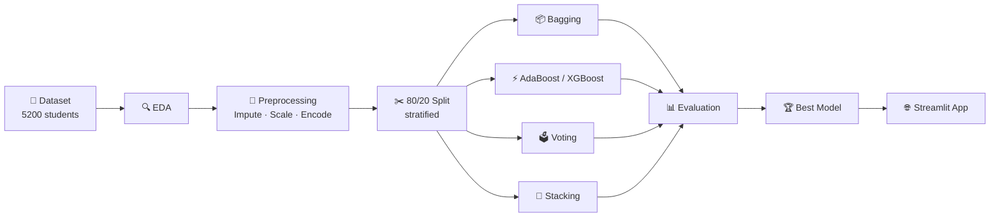

## 📂 Dataset

**5,200 students × 19 columns**: demographics, course details, engagement metrics and assessment scores.

| Group | Columns |
|---|---|
| 👤 Demographics | `age`, `country_region`, `device_type`, `education_background` |
| 📚 Course | `course_level`, `course_category`, `course_start_date`, `week_of_year` |
| 🖱️ Engagement | `sessions`, `time_spent_hours`, `videos_watched`, `forum_posts` |
| 📝 Assessment | `quiz_attempts`, `assignments_submitted`, `avg_quiz_score`, `attendance_rate` |
| 🎯 Targets | `completion_status`, `final_score` |

**Assumptions:** `student_id` dropped · `course_start_date` → `start_month` · each target is *not* used as a feature for the other task · missing values (`time_spent_hours` 112, `avg_quiz_score` 81, `attendance_rate` 80) imputed with the median.

### 🔎 Target Distributions
<p align="center">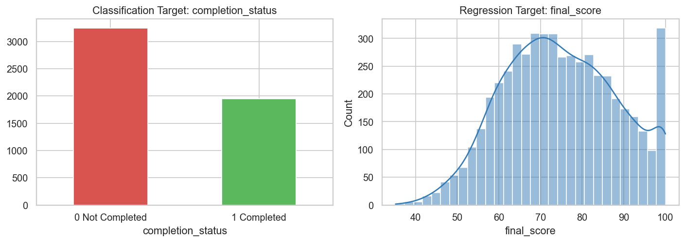</p>

> Classes are moderately imbalanced (**62.5 % Not Completed / 37.5 % Completed**), so a stratified split is used and Precision / Recall / F1 are reported along with Accuracy.

### 🔥 Correlation Heatmap
<p align="center">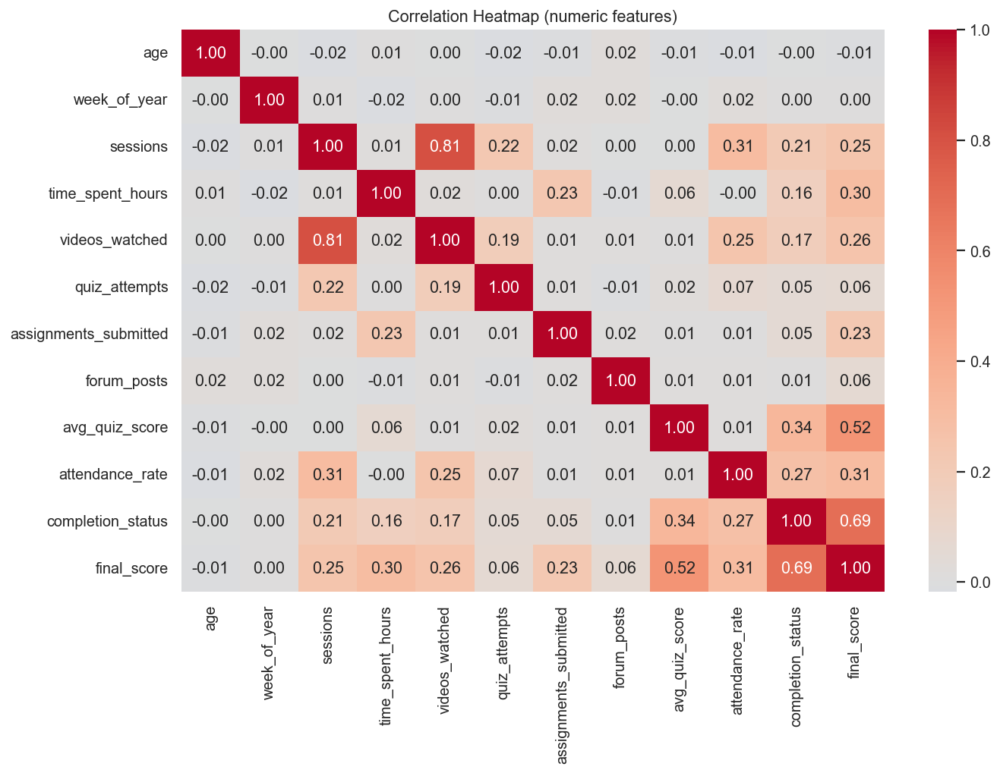</p>

---

## 🧪 Methodology (Parts A – G)

| Part | Tasks | What was done |
|---|---|---|
| 🧠 **A** Theory | 1–5 | Ensemble learning, bagging vs boosting vs voting, bias–variance, voting & stacking, AdaBoost vs XGBoost |
| 🧪 **B** Data prep | 6–8 | Features/targets, 80/20 stratified split, median-impute + `StandardScaler` + `OneHotEncoder` pipeline |
| 📦 **C** Bagging | 9–11 | Bagging Classifier & Regressor vs single tree |
| ⚡ **D** Boosting | 12–17 | AdaBoost, XGBoost, Gradient Boosting, sequential-learning analysis, 5-fold CV robustness |
| 🗳️ **E** Voting & Stacking | 18–21 | Hard vs soft voting, Stacking Classifier & Regressor with meta-learners |
| 📊 **F** Evaluation | 22, 23, 24 | Accuracy / Precision / Recall / F1 / ROC-AUC, MAE / RMSE / R², best model per task |
| 📝 **G** Report | 25–26 | Final analysis, recommendation, Streamlit app |

---

## 📦 Part C — Bagging vs Single Tree

<p align="center">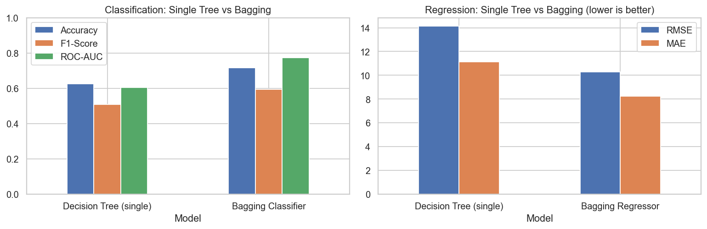</p>

| Model | Accuracy | F1 | ROC-AUC | | MAE | RMSE | R² |
|---|:---:|:---:|:---:|---|:---:|:---:|:---:|
| Decision Tree (single) | 0.625 | 0.509 | 0.604 | | 11.12 | 14.12 | −0.096 |
| **Bagging** | **0.716** | **0.595** | **0.773** | | **8.24** | **10.29** | **0.418** |

> 💡 A deep tree has **high variance**. Averaging 100 bootstrap trees cuts variance (5-fold CV ROC-AUC: single tree **0.614** → bagging **0.759**).

## ⚡ Part D — Boosting

### AdaBoost: weak learners improve step by step
<p align="center">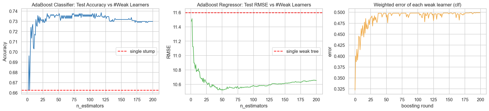</p>

> 💡 One stump gives **0.662** accuracy; after ~50 weak learners the ensemble reaches **≈ 0.736**. Each round re-weights the samples that earlier learners got wrong.

### Robustness of boosting models (5-fold CV)
<p align="center">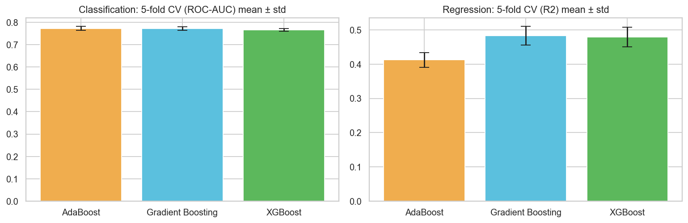</p>

| Boosting model | Classification ROC-AUC | Regression R² |
|---|:---:|:---:|
| AdaBoost | 0.7724 ± 0.0093 | 0.4121 ± 0.0212 |
| Gradient Boosting | 0.7721 ± 0.0082 | **0.4829** ± 0.0274 |
| XGBoost | 0.7653 ± **0.0063** | 0.4787 ± 0.0287 |

## 🗳️ Part E — Voting & Stacking

<p align="center">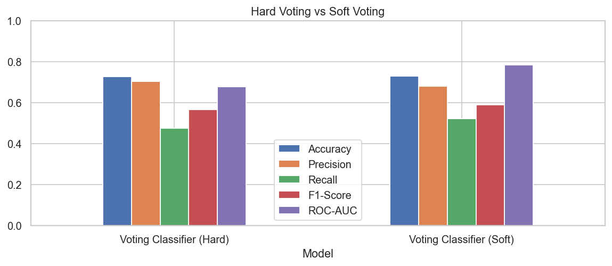</p>

| Model | Accuracy | F1 | ROC-AUC |
|---|:---:|:---:|:---:|
| Voting (Hard) | 0.728 | 0.567 | 0.677 |
| Voting (Soft) | 0.729 | 0.590 | **0.783** |
| Stacking Classifier (meta: Logistic Regression) | 0.735 | 0.609 | 0.787 |
| Stacking Regressor (meta: Ridge) | RMSE 10.19 | MAE 8.20 | R² 0.430 |

> 💡 Hard voting counts labels only; soft voting averages probabilities, so confident models matter more.

---

## 📊 Part F — Model Evaluation

### Classification
<p align="center">
  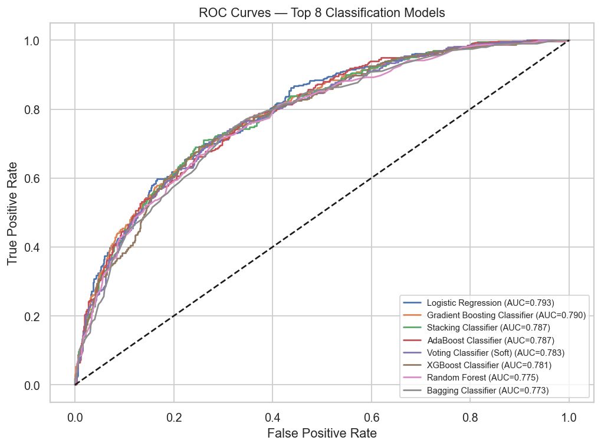
  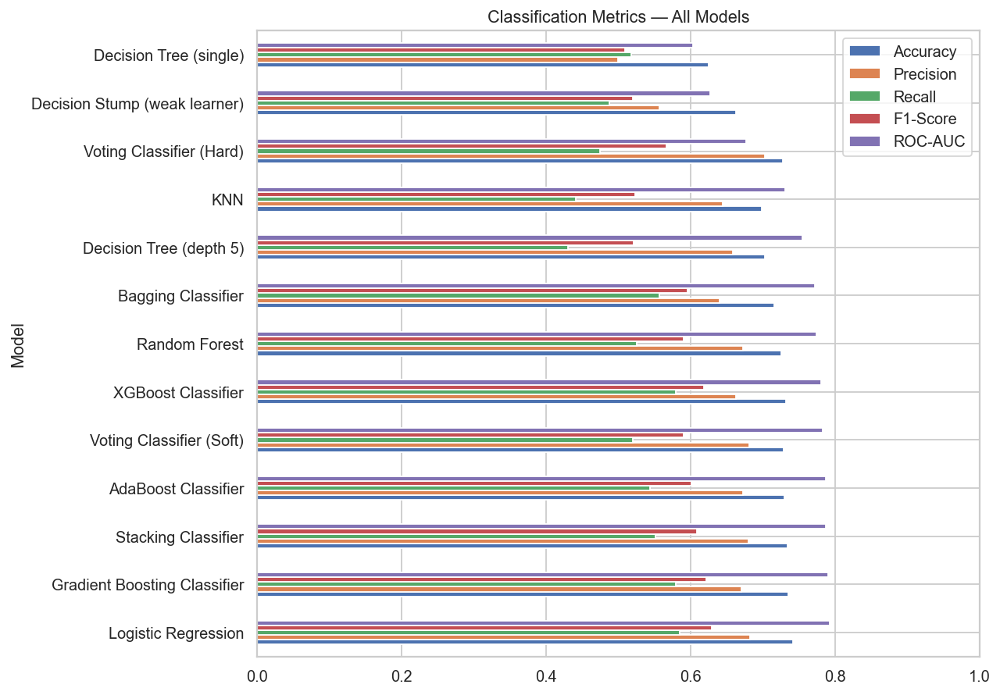
</p>

<details>
<summary><b>📋 Full classification results (click to expand)</b></summary>

| Model | Family | Accuracy | Precision | Recall | F1 | ROC-AUC |
|---|---|:---:|:---:|:---:|:---:|:---:|
| Logistic Regression | Base | 0.7423 | 0.6826 | 0.5846 | 0.6298 | 0.7928 |
| **Gradient Boosting Classifier** | Boosting | 0.7356 | 0.6706 | 0.5795 | 0.6217 | 0.7904 |
| Stacking Classifier | Stacking | 0.7346 | 0.6804 | 0.5513 | 0.6091 | 0.7871 |
| AdaBoost Classifier | Boosting | 0.7298 | 0.6730 | 0.5436 | 0.6014 | 0.7870 |
| Voting Classifier (Soft) | Voting | 0.7288 | 0.6812 | 0.5205 | 0.5901 | 0.7831 |
| XGBoost Classifier | Boosting | 0.7317 | 0.6628 | 0.5795 | 0.6183 | 0.7812 |
| Random Forest | Base | 0.7260 | 0.6721 | 0.5256 | 0.5899 | 0.7748 |
| Bagging Classifier | Bagging | 0.7163 | 0.6401 | 0.5564 | 0.5953 | 0.7727 |
| Decision Tree (depth 5) | Base | 0.7029 | 0.6588 | 0.4308 | 0.5209 | 0.7547 |
| KNN | Base | 0.6990 | 0.6442 | 0.4410 | 0.5236 | 0.7310 |
| Voting Classifier (Hard) | Voting | 0.7279 | 0.7034 | 0.4744 | 0.5666 | 0.6772 |
| Decision Stump | Base | 0.6625 | 0.5572 | 0.4872 | 0.5198 | 0.6274 |
| Decision Tree (single) | Base | 0.6250 | 0.5000 | 0.5179 | 0.5088 | 0.6036 |

</details>

<p align="center">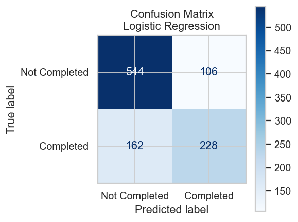</p>

> Confusion matrix of the top-ranked model overall (Logistic Regression): 544 TN · 228 TP · 106 FP · 162 FN.

### Regression
<p align="center">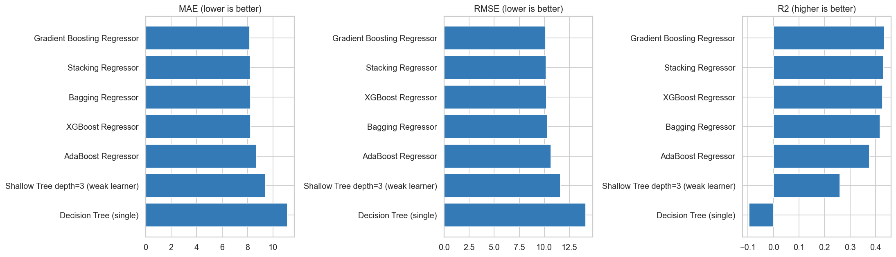</p>

| Model | Family | MAE | RMSE | R² |
|---|---|:---:|:---:|:---:|
| 🥇 **Gradient Boosting Regressor** | Boosting | **8.1631** | **10.1468** | **0.4344** |
| Stacking Regressor | Stacking | 8.1960 | 10.1850 | 0.4302 |
| XGBoost Regressor | Boosting | 8.2417 | 10.2149 | 0.4268 |
| Bagging Regressor | Bagging | 8.2389 | 10.2893 | 0.4184 |
| AdaBoost Regressor | Boosting | 8.6941 | 10.6530 | 0.3766 |
| Shallow Tree (depth 3) | Base | 9.3800 | 11.5976 | 0.2611 |
| Decision Tree (single) | Base | 11.1198 | 14.1222 | −0.0955 |

<p align="center">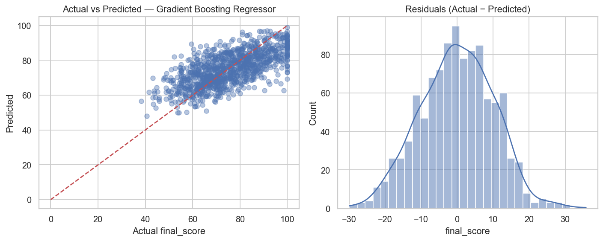</p>

> Points follow the diagonal and residuals are centred on zero, so predictions are unbiased. The average error is about **8 marks out of 100**.

---

## 📝 Part G — Final Analysis

### 🔑 What drives the predictions?
<p align="center">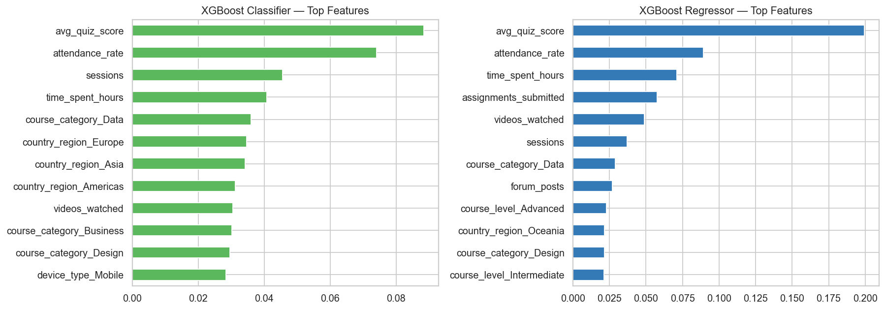</p>

### Ensemble families compared

| Family | Best ROC-AUC | Best F1 | Best RMSE | Best R² |
|---|:---:|:---:|:---:|:---:|
| Bagging | 0.7727 | 0.5953 | 10.29 | 0.4184 |
| **Boosting** | **0.7904** | **0.6217** | **10.15** | **0.4344** |
| Stacking | 0.7871 | 0.6091 | 10.19 | 0.4302 |
| Voting | 0.7831 | 0.5901 | – | – |

### ✅ Final recommendation for deployment
- **Course completion →** `Gradient Boosting Classifier`
- **Final score →** `Gradient Boosting Regressor`

> ⚖️ **Honest note:** plain Logistic Regression (ROC-AUC 0.793) is almost as good as the best ensemble, so the completion pattern is largely linear. The big win of ensembles is over the *single tree*: far more stable and accurate.

### 💼 Business value
- 🚨 Students predicted as **Not Completed** can get early reminders or mentoring.
- 🎓 The predicted **final score** shows who needs extra support before the course ends.
- 🛡️ Ensembles are more **stable** than a single model, which solves the "unstable results" problem.

---

## 🌐 Streamlit App

Enter the student details, then get the **completion probability** and the **predicted final score** instantly.

<p align="center">
  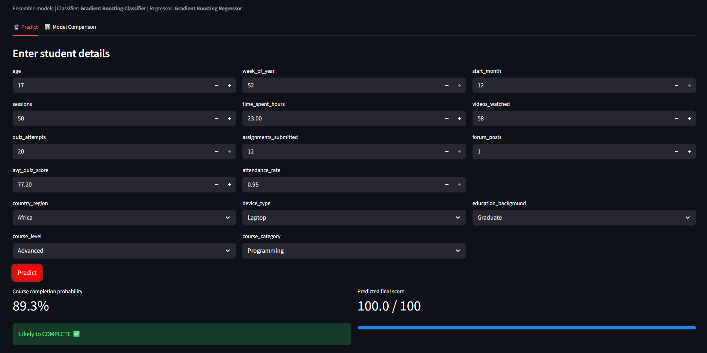
  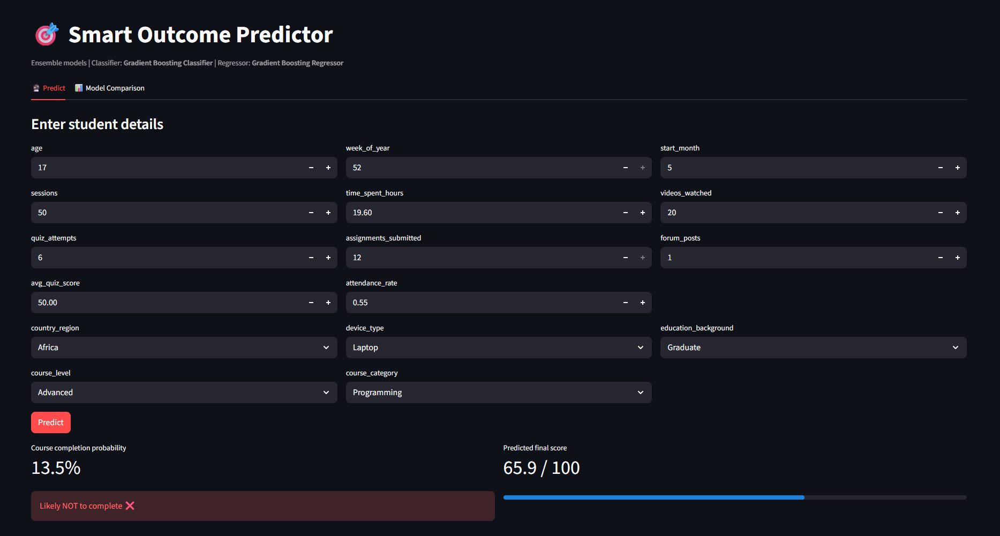
</p>
<p align="center"><i>Left: student likely to complete ✅ &nbsp;|&nbsp; Right: student unlikely to complete ❌</i></p>

---

## ▶️ Run Locally

```bash
# 1. Clone
git clone https://github.com/<your-username>/smart-outcome-predictor.git
cd smart-outcome-predictor

# 2. Install
pip install -r requirements.txt

# 3. Run the notebook (Kernel → Restart & Run All) → creates models/
jupyter notebook Smart_Outcome_Predictor.ipynb

# 4. Launch the app
streamlit run app.py
```
